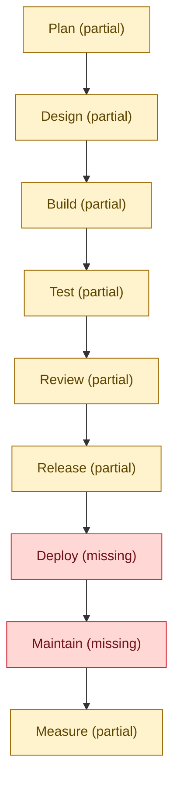
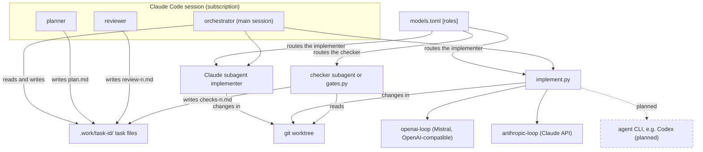
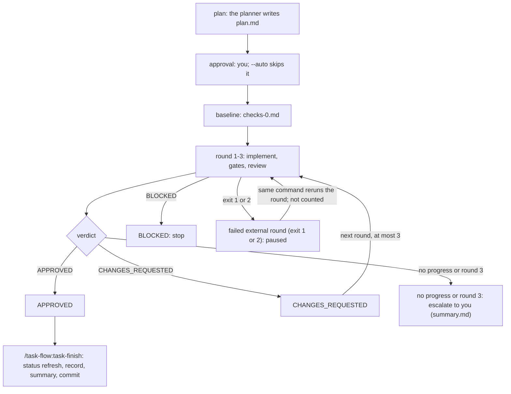

# claude-baseline

Two Claude Code plugins from one marketplace: `dev-baseline` for everyday skills and
guardrails, and `task-flow`, the main one — a reviewed multi-agent task workflow.

| Plugin | What it is | Use it when | Install | Docs |
| --- | --- | --- | --- | --- |
| `task-flow` | Multi-agent task workflow: plan, your approval, implement, checks, independent review | You want every task planned, gated and reviewed | `/plugin install task-flow@claude-baseline` | [task-flow overview](docs/task-flow/overview.md) |
| `dev-baseline` | Four skills, a reviewer agent and two hooks for every repo | Every project, installed at user scope | `/plugin install dev-baseline@claude-baseline` | [dev-baseline](docs/dev-baseline.md) |

## task-flow

`plugins/task-flow/` turns a request into a reviewed change: the planner writes a plan,
you approve it, the implementer works in a git worktree, the checker runs the gates, and
an independent reviewer judges the result — at most three rounds, all artifacts in `.work/<task-id>/`. The command list is in [Commands](docs/task-flow/commands.md). Purpose: an AI-native SDLC — agents under human gates, never unattended; generated status below, details in [AI-native SDLC status](docs/task-flow/ai-native-sdlc.md).
<!-- sdlc:status:start -->
Generated from [`docs/task-flow/sdlc-status.toml`](docs/task-flow/sdlc-status.toml) by `plugins/task-flow/scripts/sdlc_status.py render` — do not edit by hand; details: [AI-native SDLC status](docs/task-flow/ai-native-sdlc.md).

<!-- diagram:sdlc-status -->

<!-- /diagram:sdlc-status -->

| Stage | State | Achieved criteria | Missing criteria | Next task |
| --- | --- | --- | --- | --- |
| Plan | partial | Reviewed plan with testable criteria; Intent and plan record visible in git | Approval gate cannot be skipped | enforce-gates-hooks |
| Design | partial | Design captured inside plan.md | A designer role and design.md; Design reviewed before planning | designer-stage |
| Build | partial | Role boundaries enforced in hooks; Implementer chosen by config | Model-influenced commands sandboxed | command-sandbox |
| Test | partial | Baseline and deterministic gates; All checks in CI on every PR | Evals and bench run on change; Benchmark measures code quality | ci-scheduled-evals, bench-quality-scorecard |
| Review | partial | Fresh-context criterion review | Risk rating and human attention list; AI review on every PR | review-risk-flags, pr-review-ci |
| Release | partial | Controlled release with human approval | Scoped agent PRs, protected main; CI verifies and publishes tags; Rollback drill recorded | agent-pr-path, release-pipeline-ci |
| Deploy | missing | — | Agents can deploy behind a gate | unplanned |
| Maintain | missing | — | Scheduled drift and failure watch; Signals become tasks; Escapes become tests | maintain-signal-watch, task-intake, regression-from-escapes |
| Measure | partial | Stage status in the README | DORA and agent metrics | delivery-metrics |
<!-- sdlc:status:end -->
### Architecture

The roles in one Claude Code session exchange nothing but the task files.

<!-- diagram:architecture -->

<!-- /diagram:architecture -->

### Task flow

A single task runs from your request to the verdict.

<!-- diagram:task-flow -->

<!-- /diagram:task-flow -->

### What makes it different

- A [planner and an independent reviewer](docs/task-flow/overview.md) that see only files, never the implementer's reasoning.
- [Your approval gate](docs/task-flow/commands.md) before anything is built — `--auto` skips it.
- An optional, experimental [external implementer](docs/task-flow/external-implementer.md) on a cheaper per-token model via `models.toml`.
- [Autopilot](docs/task-flow/autopilot.md) for a whole list of tasks: `/task-flow:task-autopilot`.
- A [benchmark](docs/task-flow/benchmark.md) that compares implementers on frozen cases.

## Quick start

Needs Claude Code, git, and [uv](https://docs.astral.sh/uv/) on `PATH`. Install — one prompt per line:

```
/plugin marketplace add jakos/claude-baseline --scope user
/plugin install dev-baseline@claude-baseline
/plugin install task-flow@claude-baseline
```

Optional external implementer (experimental): set `MISTRAL_API_KEY` in the environment
Claude Code starts from ([Setting the key](docs/task-flow/setup.md#setting-the-key)),
copy [`plugins/task-flow/templates/models.toml`](plugins/task-flow/templates/models.toml)
to `.claude/task-flow.models.toml`, and set a real `model` with
`[roles] implementer = "mistral"` ([models.toml](docs/task-flow/setup.md#modelstoml-for-the-external-implementer)).

Check the setup with `/task-flow:task-doctor` (add `--online` once a key is set), then run
a first task: `/task-flow:task-run "<request>"`.

Stuck? See [Setting up task-flow](docs/task-flow/setup.md).

## Benchmark

The latest published comparison of implementers, written by `bench.py publish`:

<!-- bench:latest:start -->
Latest benchmark: run combined-100, 2026-11-02, 3 cases x 1 repeats, task-flow 0.12.0.

| Profile | Model | Accepted | Hidden pass | Tokens per accepted (in / cached / out) | Cost per accepted |
|  --- |  --- |  --- |  --- |  --- | --- |
| mistral-large | mistral-large-4-0 | 3/3 (100%) | 2/3 | 1,433,672 / 1,367,637 / 32,968 | $0.2112 |
| mistral-small | mistral-small-2603 | 1/3 (33%) | 1/3 | 11,666,879 / 11,073,632 / 131,571 | $0.3340 |
| glm-flash | zai-glm-5-3-flash | 3/3 (100%) | 2/3 | 6,202,722 / 5,051,136 / 80,816 | $0.3647 |
| deepseek-flash | deepseek-v4-1-flash-1017 | 3/3 (100%) | 2/3 | 1,225,506 / 1,182,549 / 13,514 | $0.0374 |

Note: this run merges rows of the runs `first-pass-2`, `rerun-100-turns`, `rerun-small-task-list`; each row records its `source_run` in the saved results.jsonl

Note: profile `mistral-small` ran with different turn limits (2 row(s) at 100 turns, 1 row(s) at 60 turns); rows are not strictly like for like

Note: profile `glm-flash` ran with different turn limits (1 row(s) at 100 turns, 2 row(s) at 60 turns); rows are not strictly like for like

Note: profile `deepseek-flash` ran with different turn limits (1 row(s) at 100 turns, 2 row(s) at 60 turns); rows are not strictly like for like


[Details and history](docs/task-flow/benchmark/latest.md) · [All results](docs/task-flow/benchmark.md)
<!-- bench:latest:end -->

Older results: [benchmark history](docs/task-flow/benchmark.md).

## Documentation

- [Documentation index](docs/README.md)
- [task-flow overview](docs/task-flow/overview.md)
- [Setting up task-flow](docs/task-flow/setup.md)
- [Commands](docs/task-flow/commands.md)
- [Autopilot and epics](docs/task-flow/autopilot.md#epics)
- [Configuration](docs/task-flow/configuration.md)
- [External implementer](docs/task-flow/external-implementer.md)
- [Benchmark](docs/task-flow/benchmark.md)
- [GETTING-STARTED.md](GETTING-STARTED.md)
- [Developing claude-baseline](docs/development.md)

## dev-baseline

Four skills, a reviewer agent and two hooks, installed at user scope so it loads in every
project — see [dev-baseline](docs/dev-baseline.md) and [GETTING-STARTED.md](GETTING-STARTED.md).

## License

MIT.
