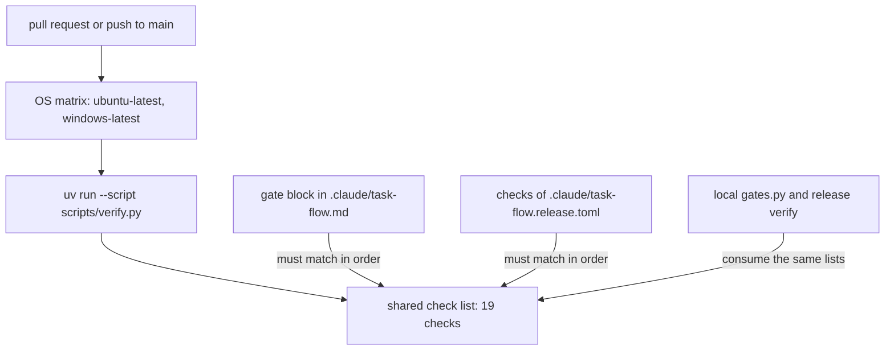

# Developing claude-baseline

## Working on this repo

The released plugin stays installed from GitHub, for every other project. Sessions started
**in this repo** load the working tree on top of it, so edits are live here and nowhere
else:

```bash
CLAUDE_CODE_PLUGIN_DIRS="$PWD/plugins/dev-baseline" claude
# both plugins; the separator is ; on Windows and : elsewhere
CLAUDE_CODE_PLUGIN_DIRS="$PWD/plugins/dev-baseline;$PWD/plugins/task-flow" claude
# or, one-off:
claude --plugin-dir ./plugins/dev-baseline
```

A session-only plugin with the same manifest name replaces the installed one for that
session — silently: `claude plugin list` still shows the installed row, and only a
`--debug` log says `from --plugin-dir overrides installed version`. Edits to a `SKILL.md`
take effect at `/reload-plugins`, with no version bump and no push.

`.vscode/settings.json` sets the variable for every integrated terminal opened in this
workspace, so `claude` typed there gets the working tree with no flag. Other terminals and
the desktop app do not, and get the released version.

What does **not** work, both tried:

- `env` in `.claude/settings.json` or `settings.local.json`. Claude Code refuses
  `CLAUDE_CODE_PLUGIN_DIRS` from project-scoped settings and logs a warning saying so.
- `claude plugin marketplace add ./`. It loads in place, but marketplaces are user-wide and
  keyed by the `name` in `marketplace.json`, so the directory source *replaces* the GitHub
  one in every project. Undo with `claude plugin marketplace add jakos/claude-baseline`.
  The same goes for `extraKnownMarketplaces` in a project's settings: it looks
  project-scoped and rewrites the same global file.

This repository's own `.claude/task-flow.models.toml` is such a project file and holds no
secrets, only the name of the key's environment variable.

## Reviewing this repo itself

`@baseline-reviewer` — a project-scoped agent in `.claude/agents/`, so it exists only here
and is not part of the published plugin. The shipped `code-reviewer` reads Python diffs
and so can never review its own repo, which is prose, JSON and a few stdlib-only Python hook scripts.

It reviews for the failure mode this repository actually has: things that load but do
nothing. A hook whose output goes to a debug log, a `hooks.json` the loader rejects whole,
a description that will not trigger, a rubric that tests what every model already does.
Its question is not "is this correct" but "if this were broken, what would tell me".

## Layout

```
.claude-plugin/marketplace.json      catalog
.claude/task-flow.md                 task-flow project rules for this repo: version rule, verification commands
.claude/task-flow.models.toml        this repo's models.toml: four Mistral profiles, [roles] implementer; no secrets
.claude/task-flow.release.toml       release targets for /task-flow:task-release
docs/                                documentation pages; index in docs/README.md
docs/task-flow/benchmark/            generated by bench.py publish (latest, history)
plugins/dev-baseline/
    .claude-plugin/plugin.json       manifest
    skills/<name>/SKILL.md           four skills
    agents/code-reviewer.md          read-only reviewer
    hooks/hooks.json                 attribution guard, python formatter
    scripts/block_attribution.py
    scripts/format_python.py
    templates/CLAUDE.md.template
    evals/<case>/                    behavioural tests: does the skill fire
plugins/task-flow/                   multi-agent task workflow; see its README
    agents/                          planner, implementer, checker, reviewer, backlog
    skills/                          workflow contract, 4 profiles, 12 commands
    hooks/hooks.json, scripts/guard.py
    scripts/rules.py                 denial rules shared by guard.py and implement.py
    scripts/task_list.py             table for task-list
    scripts/prune_task.py            task-finish keeps .md, impl-*.json and worktree/
    scripts/autopilot.py             task-autopilot: repo check, --tasks list check, token estimate, circuit breaker, stacked base
    scripts/implement.py             one implementer round on an OpenAI-compatible or Anthropic Messages API model, used when [roles] implementer names a profile
    scripts/drivers.py               the per-provider request/response formats of implement.py (openai-loop, anthropic-loop)
    scripts/launch.py                starts .cmd/.bat tools on Windows through cmd.exe, shared by implement.py
    scripts/gates.py                 runs plan.md's verification commands without a model, when [roles] checker = "script"
    scripts/models.py                reads, merges and validates models.toml
    scripts/doctor.py                read-only environment and configuration check behind /task-flow:task-doctor
    scripts/release.py               task-release: preconditions, version files, changelog, commit and tag; never pushes on its own
    scripts/verify.py                CI entry point: runs the shared check list, refusing list drift or unregistered tests
    scripts/sdlc_status.py           AI-native SDLC status: validate, check, render, done and finish (opt-in, see docs/task-flow/ai-native-sdlc.md)
    bench/bench.py, bench/publish.py, bench/README.md  benchmark harness and publisher:
                                implementer profiles on frozen cases, cost per accepted task
    bench/cases/<id>/                frozen benchmark cases (case.toml, plan.md, NOTES.md)
    bench/results/log.md             generated results log over the saved benchmark runs
    templates/models.toml            commented models.toml example (profiles, [roles])
    templates/release.toml           commented release config example (targets, version files)
    tests/test_guard.py, tests/test_rules.py, tests/test_task_list.py, tests/test_prune_task.py,
    tests/test_autopilot.py, tests/test_bench.py, tests/test_bench_publish.py,
    tests/test_gates.py, tests/test_models.py,
    tests/test_drivers.py, tests/test_doctor.py, tests/test_docs.py, tests/test_implement.py, tests/test_launch.py,
    tests/test_release.py, tests/test_ci.py, tests/test_sdlc_status.py
```

Validate before pushing:

```bash
claude plugin validate .            # manifests: schema and syntax
cd plugins/dev-baseline && claude plugin eval .   # behaviour: do the skills fire
```

## Continuous integration (GitHub Actions)

`.github/workflows/ci.yml` runs the shared task-flow check list on every pull request
and every push to `main`, on both `ubuntu-latest` and `windows-latest` (one matrix job,
`fail-fast: false`, job names `checks (ubuntu-latest)` and `checks (windows-latest)`,
`permissions: contents: read`, a 60-minute job timeout, no path filters, no
`continue-on-error`, no secrets and no model calls). Both jobs run the same entry point
as the local gates and the release verify — there is no third copy of the list:

```bash
uv run --script plugins/task-flow/scripts/verify.py
```

`scripts/verify.py` reads `[targets.task-flow].checks` of
`.claude/task-flow.release.toml` and the `## Verification commands` block of
`.claude/task-flow.md`, and refuses to run anything when the two lists disagree entry
by entry, in order, or when a discovered `plugins/task-flow/tests/test_*.py` is
missing, duplicated or stale in them — so a new test file is added to both lists by
hand (the parity guard; see [Deterministic gates](task-flow/gates.md) and
[Releasing](task-flow/releasing.md)). Each check then runs from the repository root with
its argument list (on Windows a `.cmd`/`.bat` tool goes through `scripts/launch.py`),
prints one `PASS` / `FAIL` / `ERROR` / `NOTRUN` line, continues after failures, and
exits nonzero when any check failed, was denied, could not start, timed out or had no
program on `PATH`. That exit code — not a report — is the CI signal, unlike
`scripts/gates.py`, which records task-round failures as data in `checks-<n>.md` and
exits zero.



Pins, all recorded in the workflow file: `actions/checkout` v6.1.0 and
`astral-sh/setup-uv` v6.8.0 at verified full 40-character commit SHAs (checkout with
`persist-credentials: false`), uv 0.12.21 with caching keyed on the PEP 723 scripts
and tests through `cache-dependency-glob` (there is no lockfile), Python 3.14.7
(uv-managed), and the Claude CLI `@anthropic-ai/claude-code@2.1.316` from npm with the
auto-updater disabled (`DISABLE_AUTOUPDATER=1`, `DISABLE_TELEMETRY=1` in the workflow
environment). Ruff runs as `uvx ruff==0.17.3` against the committed `ruff.toml`.
Windows steps use the runner's native default shell, not Git Bash.

Validator evidence, recorded 2026-11-02: `claude plugin validate .` was run on Windows
with Claude Code CLI 2.1.316 from the repository root, with `CLAUDE_CONFIG_DIR`, `HOME`,
`USERPROFILE`, `APPDATA` and `LOCALAPPDATA` all pointed at a fresh empty temporary
directory (empty configuration, no credentials anywhere in the environment), stdin
closed and a 180 s timeout: exit 0, `Validation passed` — no login and no model call.
The Linux and hosted-runner results stay pending until the first authorized push or
pull request (a follow-up for the user); a pending hosted result does not fail this
change.

Pre-existing lint findings, identical to the round-0 baseline and deliberately not
fixed here: `ruff check` reports 7 errors — I001 import sorting in `bench/bench.py`
(line 65), `scripts/models.py` (line 86), `scripts/release.py` (line 57),
`tests/test_bench.py` (line 18) and `tests/test_models.py` (line 10), UP017 in
`bench/bench.py` (line 140), RUF012 in `tests/test_bench.py` (line 1541) — and
`ruff format --check` would reformat `bench/bench.py`, `tests/test_bench.py` and
`tests/test_bench_publish.py`. The committed `ruff.toml` pins the target version
(py311) that the pinned Ruff 0.17.3 resolves by default (checked with
`ruff check --show-settings`; no user-level Ruff configuration is involved), so a clean
runner matches the local gate result.

Branch protection for `main` — exact user steps, to do in the GitHub web UI after the
first CI run, changing nothing else: Settings → Branches → Add branch protection rule
(or edit the existing rule for `main`) → check "Require a pull request before merging"
→ check "Require status checks to pass before merging" → in that setting's search box,
add both `CI / checks (ubuntu-latest)` and `CI / checks (windows-latest)` (they appear
once they have run) → Save changes.
