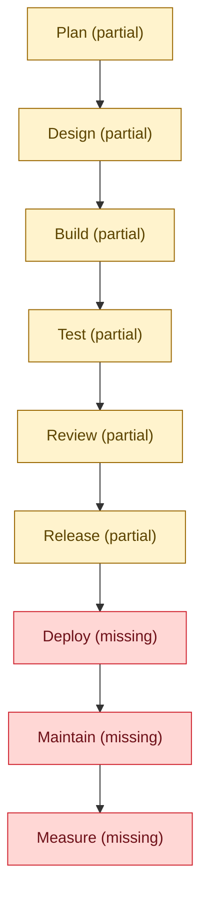

# AI-native SDLC status

task-flow's purpose is an AI-native SDLC: agents plan, implement, check and review
software, and a human stays behind every gate — the plan approval, the round verdict
and the release approval. Autonomy here is assisted, never unattended. Locally, ADLC
(agent-driven development life cycle) means the same development life cycle run by
agents under those human gates; it is not a claim that no human is involved.

This page and the `sdlc:status` block of [the front page](../../README.md) are
generated by `plugins/task-flow/scripts/sdlc_status.py` from
[`docs/task-flow/sdlc-status.toml`](sdlc-status.toml) — the committed source of every
stage's criteria, states, evidence and closing tasks. Do not edit them by hand:
`uv run --script plugins/task-flow/scripts/sdlc_status.py render` regenerates both,
`uv run --script plugins/task-flow/scripts/sdlc_status.py check` (one of this
repository's gates, see [Deterministic gates](gates.md)) fails when they are stale,
and `/task-flow:task-finish` marks the criteria a task declares done and re-renders
before its commit (see
[orchestration](../../plugins/task-flow/skills/workflow/orchestration.md)).

## Current status

Generated from [`docs/task-flow/sdlc-status.toml`](sdlc-status.toml); do not edit by hand.

<!-- diagram:sdlc-status -->

<!-- /diagram:sdlc-status -->

| Stage | State | Achieved criteria | Missing criteria | Next task |
| --- | --- | --- | --- | --- |
| Plan | partial | Reviewed plan with testable criteria | Intent and plan record visible in git; Approval gate cannot be skipped | task-record-in-git, enforce-gates-hooks |
| Design | partial | Design captured inside plan.md | A designer role and design.md; Design reviewed before planning | designer-stage |
| Build | partial | Role boundaries enforced in hooks; Implementer chosen by config | Model-influenced commands sandboxed | command-sandbox |
| Test | partial | Baseline and deterministic gates | All checks in CI on every PR; Evals and bench run on change; Benchmark measures code quality | ci-github-actions, ci-scheduled-evals, bench-quality-scorecard |
| Review | partial | Fresh-context criterion review | Risk rating and human attention list; AI review on every PR | review-risk-flags, pr-review-ci |
| Release | partial | Controlled release with human approval | Scoped agent PRs, protected main; CI verifies and publishes tags; Rollback drill recorded | agent-pr-path, release-pipeline-ci |
| Deploy | missing | — | Agents can deploy behind a gate | unplanned |
| Maintain | missing | — | Scheduled drift and failure watch; Signals become tasks; Escapes become tests | maintain-signal-watch, task-intake, regression-from-escapes |
| Measure | missing | — | Stage status in the README; DORA and agent metrics | sdlc-status-readme, delivery-metrics |

Stage states are derived from the criteria, never stored: all criteria done = `achieved`, some = `partial`, none = `missing`. Every node also carries its state as text, so the colours are never the only signal.

## What stays with the human, per stage

| Stage | What stays with the human | Aspirational autonomy |
| --- | --- | --- |
| Plan | approves the plan — the approval gate cannot be skipped | L1 |
| Design | reviews the design captured in plan.md before anything is built | L1 |
| Build | reviews the diff and the check results of every round | L2 |
| Test | reads checks-n.md; CI re-runs the gates on every pull request | L2 |
| Review | reads the independent reviewer's verdict and decides | L1 |
| Release | approves every release; push, PR and tag only after asking | L3 (aspirational) |
| Deploy | decides and runs every deployment today | L0 |
| Maintain | triages the signals that become tasks | L2 |
| Measure | reads this status page and the delivery metrics | L2 |

## Autonomy levels (aspirational)

A direction, not a claim — no stage above L2 is reached today:

| Level | Meaning |
| --- | --- |
| L0 | the human does the work |
| L1 | the agent drafts, the human decides |
| L2 | the agent runs gated steps, the human owns the gates |
| L3 | the agent runs a whole stage, the human audits |
| L4 | unattended — explicitly not a goal |

Current limits: the achieved stages are achieved against the criteria below with a
human at every gate; Deploy is missing entirely and stays with a human (L0); no
unattended operation is implemented or claimed anywhere.

## Criteria, evidence and closing tasks

| Stage | Criterion | Title | State | Evidence | Closing task |
| --- | --- | --- | --- | --- | --- |
| plan | plan-gate | Reviewed plan with testable criteria | done | `plugins/task-flow/skills/workflow/SKILL.md` | — |
| plan | intent-in-git | Intent and plan record visible in git | open | — | task-record-in-git |
| plan | gate-enforced | Approval gate cannot be skipped | open | — | enforce-gates-hooks |
| design | design-in-plan | Design captured inside plan.md | done | `plugins/task-flow/agents/planner.md` | — |
| design | design-role | A designer role and design.md | open | — | designer-stage |
| design | design-gate | Design reviewed before planning | open | — | designer-stage |
| build | guardrails-hooks | Role boundaries enforced in hooks | done | `plugins/task-flow/hooks/hooks.json` | — |
| build | swappable-implementers | Implementer chosen by config | done | `plugins/task-flow/templates/models.toml` | — |
| build | isolated-execution | Model-influenced commands sandboxed | open | — | command-sandbox |
| test | baseline-gates | Baseline and deterministic gates | done | `plugins/task-flow/scripts/gates.py` | — |
| test | ci-on-pr | All checks in CI on every PR | open | — | ci-github-actions |
| test | evals-on-change | Evals and bench run on change | open | — | ci-scheduled-evals |
| test | quality-benchmark | Benchmark measures code quality | open | — | bench-quality-scorecard |
| review | independent-reviewer | Fresh-context criterion review | done | `plugins/task-flow/agents/reviewer.md` | — |
| review | risk-flags | Risk rating and human attention list | open | — | review-risk-flags |
| review | pr-review | AI review on every PR | open | — | pr-review-ci |
| release | release-gate | Controlled release with human approval | done | `plugins/task-flow/skills/task-release/SKILL.md` | — |
| release | agent-pr-path | Scoped agent PRs, protected main | open | — | agent-pr-path |
| release | release-pipeline | CI verifies and publishes tags | open | — | release-pipeline-ci |
| release | rollback-rehearsed | Rollback drill recorded | open | — | release-pipeline-ci |
| deploy | deploy-adapter | Agents can deploy behind a gate | open | — | unplanned |
| maintain | signal-watch | Scheduled drift and failure watch | open | — | maintain-signal-watch |
| maintain | intake-loop | Signals become tasks | open | — | task-intake |
| maintain | regression-from-escapes | Escapes become tests | open | — | regression-from-escapes |
| measure | sdlc-status-view | Stage status in the README | open | `README.md` | sdlc-status-readme |
| measure | delivery-metrics | DORA and agent metrics | open | — | delivery-metrics |

## Sources

- [`docs/task-flow/sdlc-status.toml`](sdlc-status.toml) — the committed criteria
  source; this page and the front-page block are generated from it.
- `plugins/task-flow/scripts/sdlc_status.py` — validation, `check`, `render`, `done`
  and `finish`.
- [The front page](../../README.md) — the generated `sdlc:status` block.
- [Commands](commands.md) — `/task-flow:task-finish` runs the refresh before its
  commit.
