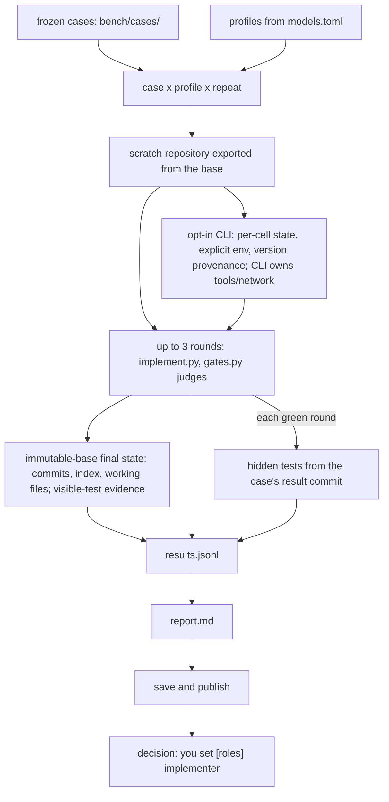

# Benchmark

Paths such as `scripts/…`, `skills/…`, `agents/…`, `templates/…` and `bench/…` are inside `plugins/task-flow/`.

`bench/bench.py` runs the implementer profiles from `models.toml` on frozen task cases
(`bench/cases/<id>/`, each case × profile × repeat) in isolated scratch repositories —
up to 3 rounds of `scripts/implement.py` judged by `scripts/gates.py`, with isolated
hidden acceptance probes after every green round — and reports cost per accepted task in
`.work/_bench/<run-id>/report.md`:

```
uv run --script plugins/task-flow/bench/bench.py run --profiles <name> [--review] ...
```

The suite has three frozen cases built from finished tasks of this repository —
`bench/cases/task-list` (S), `bench/cases/finish-prunes-task-folder` (M) and
`bench/cases/autopilot-plan-and-run-tasks` (L), each with its `case.toml`, plan copy and
`NOTES.md`. `bench.py add-case` writes a new case folder from any repository and commit
pair, `bench.py check-case <id>` calibrates a case (its hidden tests must pass on the
result tree and fail on the base tree), and `bench.py log` regenerates the committed
results log `bench/results/log.md` from the saved runs (`save` refreshes it too, and
`save --replace` re-saves an extended run). `bench.py publish` turns a saved run into
the committed benchmark pages — `docs/task-flow/benchmark/latest.md` with its SVG
chart, the history under `docs/task-flow/benchmark/history/`, the index
`docs/task-flow/benchmark.md` and the `bench:latest` block in the root `README.md` —
deterministically, from the saved run alone.

It spends model budget (and with `--review`, Claude limits too), so it is never run by
the gates — only its test is. See [bench/README.md](../../plugins/task-flow/bench/README.md) for the case
format, all commands and flags, the run layout, isolation and safety, and the limits.

## Measurement protocol (version 2)

CLI documentation and authentication review: **2026-11-06**; every authenticated
tool test is **untested**. The [tool/authentication matrix](../../plugins/task-flow/bench/README.md#cli-toolauthentication-matrix-checked-2026-11-06)
links official invocation, output, isolation, authentication, pricing and terms
evidence for Codex, Gemini CLI, Copilot CLI, OpenCode and Claude. Codex's official
account workflow is documented; Gemini Google-login, Copilot and Claude subscription
benchmark routes remain unresolved here. OpenCode Go/Zen and each upstream provider
require separate terms decisions. Unresolved routes are excluded from the manual
checklist until resolved; a login is not evidence of permission.

The saved `first-pass-2` and `combined-100` measurements use harness version 1 and
one repeat. Their outcomes and turn limits differ; merged rows reuse source work,
so a merge is not independent repeat evidence. Uncontrolled cold-versus-warm
observations cannot distinguish cache effects from scheduling or time effects.
Repeating alone does not control provider caching or time effects.

Keep model, resolved profile settings, reviewer settings, limits and suite fixed.
Execute sequentially, recording execution order. Keep normal provider caching;
send no warm-up requests and add no cache-busting nonces. The main comparison is
gates-only. Choose an explicit case subset for a separate `--review` comparison;
reviewer usage and limits belong to that comparison's total work.

A descriptive ranking requires at least **five completed independent repeats per
case/profile**, with complete coverage. Smaller or incomplete samples are
exploratory. Retain unsuccessful and capped outcomes as data. Changed caps require
a separately labelled experiment. Report per-case medians, IQR and min–max with
denominators; cases are not interchangeable repeats. Cross-case summaries are
labelled separately. Quantiles use linear interpolation at index `(n - 1) * p`
in sorted values; IQR is Q(0.75) minus Q(0.25). Missing legacy observations are
unavailable, never inferred from final quality. Do not rank across review modes,
harness versions, fingerprints or measurement settings.

### Provisional regression alarm

Compare ten independent repeats per compared case/profile under compatible fixed
settings, then run a second independent ten-repeat confirmation batch. Alarm only
when both batches show either an acceptance or hidden-pass decrease of at least
20 percentage points, or a median total cost/time increase of at least 20% which
also exceeds the larger compared IQR. Use all scheduled cells as success
denominators; list missing and not-observed results. These are operational
thresholds, not universal statistical significance or power claims; calibrate them
with future data. Neither a merge nor replacing selected failures is confirmation.

### Optional controlled cache experiment

This remains manual and unpaid in this task. Fix model, settings, prompts and
concurrency (one); alternate or counterbalance cold and warm conditions and record
their order. Record first-turn cache usage separately from conversation-turn usage.
Provider cache state is uncertain even when a request is labelled cold.
For K paired conditions and T turns per condition, plan `2 * K * T` requests,
plus W preparation requests: `2 * K * T + W` requests in total. Before running, set
a spending cap B and obtain provider evidence for prices. For each request use
`cost = (uncached_input * P_input + cached_input * P_cached + output * P_output)
/ 1_000_000`; sum over all requests, including retries, and stop before B. Cached
prices are unverified until provider evidence is supplied. No prices or paid
experiment are established here.

## How a benchmark run works

One `bench.py run` measures what an implementer profile costs per accepted task: each
frozen case × profile × repeat drives up to three rounds of `scripts/implement.py`
judged by `scripts/gates.py` in a scratch repository, probing each green round in
a disposable hidden-test copy before acceptance or review.



The diagram cannot carry: the scratch repository is exported from the case's base
commit and has no history, so the implementer can never read the hidden tests from git;
network retrieval of public solutions or tests remains possible. A CLI owns its
prompts, tools, repository instructions, configuration and network access;
`rules.py` does not control its internal loop. State isolation is not a security
sandbox. Final-state evidence includes committed, staged, unstaged and untracked
changes against the original base, plus visible-test additions/modifications/deletions.
Green gates alone do not establish untouched tests. The decision at the end is yours — `[roles] implementer` in `models.toml` picks what the
next real task uses.

### Manual CLI comparison

Require explicit user confirmation before any authenticated run. Follow the
[manual checklist](../../plugins/task-flow/bench/README.md#manual-cli-run-checklist):
Codex first **before 2026-11-25**, then Gemini API, Copilot only after resolving
its subscription terms, OpenCode API and Claude API. All authenticated tests are
currently untested. Do not substitute a third-party subscription adapter.

Use a pinned local executable, reviewed model/argv, `benchmark_isolation` and an
explicit `--cli-state-dir` separate from `--out`. The user provisions auth in each
cell's private tool home through documented login or approved env names; personal
config directories are never copied. `benchmark_version_command` is an optional
offline version probe override. Record the actual plan fee with optional
`subscription_monthly_usd`; unknown marginal subscription cost stays null.
No CLI-specific setting changes ordinary implementer defaults.

Three frozen cases × one profile × one repeat = **3 cells / up to 9 rounds**;
five repeats = **15 cells / up to 45 rounds** per profile. Five tools at five repeats
would schedule **75 cells / up to 225 rounds**, plus bounded infrastructure retries
and reviewer work when selected. Check subscription quota exposure for the full
CLI loop. For API estimates, multiply uncached input, cached input and output tokens
by their verified per-million prices, divide by 1,000,000 and sum all attempts.
Set provider spending limits and deadlines; `--max-cost-usd` cannot cap a CLI's
internal loop. Missing API usage stops later scheduling under a harness cap.
Budget reviewer charges/limits separately for an explicit `--review` subset.

After confirmation and private auth preparation, the Codex command is:

```
uv run --script plugins/task-flow/bench/bench.py run --profiles bench-codex --run-id cli-codex-20261106 --repeat 1 --infra-retries 0 --keep-code --cli-state-dir .bench-private --out .work/_bench
```

Keep `--keep-code` for later scoring. Measure free disk space for retained code,
private CLI state and attempts. `save` preserves metadata/rows/report, not code or
credentials. Archive scoring inputs separately after secret inspection. After
scoring, remove only that run's scratch code and private state after logout/revocation;
preserve run metadata, results, attempts and reports. Verify resolved cleanup paths.

Reports and published pages separate API spend, unknown subscription marginal cost
and contextual plan fees; they show tool versions, isolation limitations, acceptance,
hidden pass, rounds, coverage and wall time. Historical provenance is unknown.
Harness version 3 changes final-state measurement; saved versions remain readable.
Suite identity plus per-profile settings/provenance fingerprints prevent changed
CLI versions, argv, model, usage parser or isolation settings from pooling silently.
Adding a distinct profile remains supported. Never present a CLI/API comparison as
isolating model quality from agent-harness differences.

## Interpreting published wall times

Published tables and the README show `Seconds per run, median (min-max)` from
saved total `seconds`, not `implement_seconds`, rounded to one decimal place.
For each profile and size (including All), accepted rows supply the median,
minimum and maximum and the label `time to accepted`. Acceptance follows the
existing outcome and is independent of hidden-test success. When none accepted,
all non-skipped finished rows supply `0 accepted; time until stop`; this can
include early failures and does not describe successful completion. Empty
populations show `n/a`. Skipped rows never supply a time.

Total wall time includes provider and network latency, rate-limit waits and
retries when they occur. Configured retry counts are not observed retry attempts.
Provider load, turn counts and time of day affect elapsed time, so repeated cells
can vary. The UTC start window runs from the first to the last available
non-skipped row start, not the end of execution. Missing timestamps are reported
as incomplete coverage or an unavailable window; no starts are inferred.

With one repeat, each case/profile cell's time is a single sample, not a
measurement of typical performance. All pools different cases, even with one
repeat; these are not identical repeat samples. A displayed population containing
only one row is labelled `single sample` even in a run configured for more repeats.
Compare times only within one published run's table, never across days.
Overlapping model min-max spreads do not support an ordering; non-overlap alone
also does not establish one. Merged rows reuse source work and cannot support
strict like-for-like comparisons. The time figures carry `merged run` and,
for affected profiles, `mixed turn limits` markers beside them; consult the
source-run and turn-limit notes before interpreting the table.

## Re-running, adding a model and publishing

Re-run when something measured changes — a new model, a new price or a new profile, or
a raised `HARNESS_VERSION` in `bench.py` (a new fingerprint; see "When to re-run"). The
workflow is:

1. `run --profiles a,b [--repeat N]` — measure;
2. `save <run-id>` — keep the run in `bench/results/<run-id>/` (committed data, so the
   published pages are reproducible byte for byte from it);
3. `publish` — write the pages (below).

Recover an interrupted experiment with `run --resume <run-id>`: only missing cells
run, using recorded settings and sequential order. Completed failed, skipped and capped
outcomes remain data. Profiles may be omitted; conflicting explicit settings, changed
profile/reviewer settings, fingerprint mismatches and damaged or duplicate rows refuse
before mutation. Resume excludes `--extend` and `--run-id`; a complete run makes no
model calls. Interrupted scratch directories are retained and never reused.

`--infra-retries N` defaults to two additional attempts (zero disables, negatives
refuse). Structured exhausted HTTP 408/429/5xx, connection and transport/process
timeouts qualify; arbitrary exceptions, malformed responses, authentication failures,
visible test timeouts and model outcomes do not. Request-level retries have their own
bound. Restore code, index, untracked files and task artifacts before retrying the same
logical round. Separate attempt evidence preserves known usage and elapsed time,
including reviewer usage. Missing billing stays unknown; a spending cap prevents
further calls when remaining budget cannot safely be established. Identifiable reviewer
process timeouts use the same bounded rule. Prompt-input digests detect changed
extra instructions on resume. Reports distinguish unknown API billing from subscriptions
and include persisted interrupted-attempt work in known totals; a crash before metrics
were persisted leaves usage unknown.

Never selectively replace `max_turns` or capped outcomes to improve a ranking.
Changed caps require a separately labelled experiment. Merges reuse source rows and
are exploratory; they are not independent repeat evidence.

Adding a model to an existing run:

1. add the profile to `.claude/task-flow.models.toml`;
2. `run --extend <run-id> --profiles <new>` (the fingerprint must match);
3. `save --replace <run-id>`;
4. `publish` — the extended run appears with the new profile; no history page is
   created, because the run id is the same.

`publish` reads only `<results-dir>/<run-id>/{run.json,results.jsonl}` — with no `--run`
it takes the newest saved run (by `run.json` `created`, then run id) — and writes:

- `docs/task-flow/benchmark/latest.md` and `latest.svg` — the run's setup (cases with
  sizes, repeats, review, models with billing and prices, harness version, fingerprint,
  task-flow version), one table per size plus `All`, and the chart: tokens per accepted
  task (input / cached / output stacked) and cost per accepted task;
- `docs/task-flow/benchmark/history/<date>-<run-id>.md` + `.svg` — the previously
  published latest, copied when a new latest is written (only its chart link and index
  link are rewritten to the history paths);
- `docs/task-flow/benchmark.md` — the history index between the markers
  `<!-- bench:history:start -->` and `<!-- bench:history:end -->` (the file is created
  with `# Benchmark`, a link to this README and the empty block when missing);
- the block between the two marker lines in the root `README.md`:

  ```
  <!-- bench:latest:start -->
  <!-- bench:latest:end -->
  ```

  Each marker must occur exactly once, on its own line, start before end. `publish`
  refuses (exit 2, and nothing is written — not even the docs pages) when the README
  lacks them, and names the file and the two marker lines to add; an existing
  `docs/task-flow/benchmark.md` without the history markers is refused the same way.

A **new baseline** is a run whose fingerprint differs from the published latest's. It is
not refused — it is labelled: `latest.md` and the README block carry `New baseline: the
suite changed since run <prev-id>; results are not comparable with earlier runs.`, the
history index marks the row `new baseline`, and stdout ends with `; new baseline`. A run
*older* than the published latest, or one whose rows mix fingerprints or harness
versions, is refused (exit 2): start a new baseline with `bench.py run` and `save` it.
Results that cannot be compared are never mixed into one table.

The honesty rules, in the tables, the chart and the README block: repeats come with their
spread (median with min–max); a profile with a `skipped` / `unavailable` / `cost_cap`
row, or with missing (case, repeat) runs, is marked `(partial)` and the reason is named;
accepted is shown as `k/n (p%)` with the percentage rounded down (199 of 200 shows
`99%`, never `100%`); a subscription profile shows `subscription` in the cost columns
and no cost bar; a profile with 0 accepted shows `n/a (0 accepted)` and no bars.

The generated files are committed and must never be edited by hand — run `publish`
again instead; the same saved run gives byte-identical files, and publishing the same
run twice in a row changes no file. `publish` spends nothing and never runs the
benchmark; `run` does — that is the difference between the two.

The list below is written by `bench.py publish`; do not edit it by hand.

<!-- bench:history:start -->
Rows are comparable only when their fingerprints are equal; a `new baseline` row marks a suite change.

| Date | Run | Fingerprint | Profiles | Page |
|  --- |  --- |  --- |  --- | --- |
| 2026-11-02 | combined-100 | sha256:dbd92482d923 | mistral-large,mistral-small,glm-flash,deepseek-flash | latest |
<!-- bench:history:end -->

## Promoting routing evidence manually

The shipped default is disabled routing with no numeric thresholds. User-supplied bounds
are deterministic policy, not a benchmark-backed recommendation. Do not recommend or
enable default thresholds until saved repeated evidence qualifies:

1. Save run ids and protocol fingerprints, keeping review modes, routing rule digests
   and protocol versions separate.
2. Record per-computed-band repeat counts meeting the established minimum of five
   completed independent repeats per case/profile for a descriptive ranking.
3. Review median and spread, acceptance, hidden-pass and cost, keeping unknown costs
   unknown and checking profile-specific caps and actual fallback evidence.
4. Link the qualifying saved runs and explain the promotion decision before changing
   any recommended defaults. No qualifying saved evidence is claimed here.

Harness results add optional `routing` evidence copied from implementation metrics.
Legacy rows without it remain readable and explicitly unknown. Declared case `size`
is distinct from computed routing `band`; case labels never prove a routing decision.
Reports aggregate computed band/selected profile only within a protocol fingerprint,
review mode, routing schema and rule digest. Costs stay unknown when unavailable.
Fixed case/profile/repeat experiments replace active user routing with their explicit
scalar profile. Harness version 2 changes the measurement protocol and fingerprint;
version-1 saved results remain historical evidence and require a new baseline for the
per-round probe. No paid models are contacted to calibrate thresholds.
