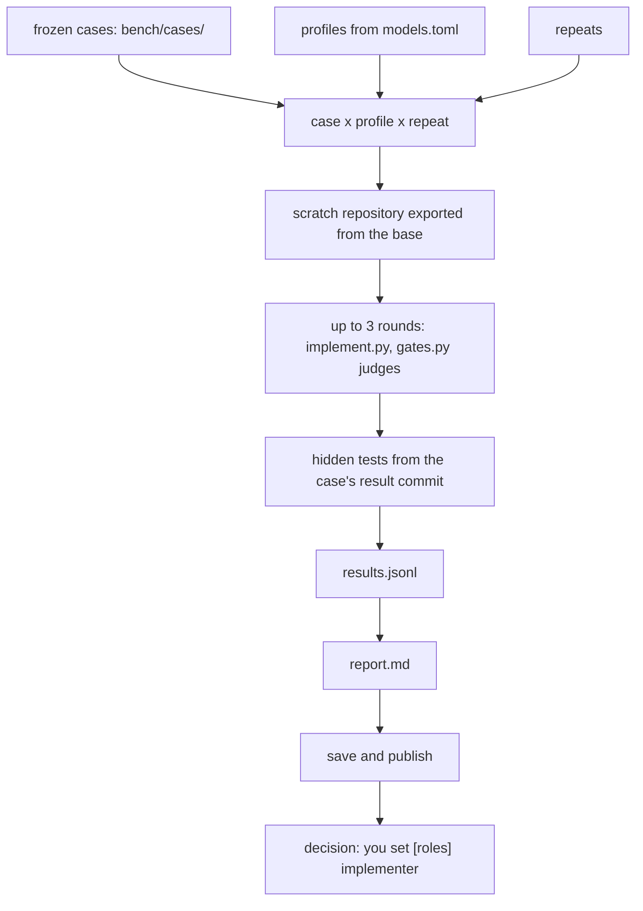

# Benchmark

Paths such as `scripts/…`, `skills/…`, `agents/…`, `templates/…` and `bench/…` are inside `plugins/task-flow/`.

`bench/bench.py` runs the implementer profiles from `models.toml` on frozen task cases
(`bench/cases/<id>/`, each case × profile × repeat) in isolated scratch repositories —
up to 3 rounds of `scripts/implement.py` judged by `scripts/gates.py`, then the case's
hidden acceptance tests — and reports cost per accepted task in
`.work/_bench/<run-id>/report.md`:

```
uv run --script plugins/task-flow/bench/bench.py run --profiles <name> [--review] ...
```

The suite has three frozen cases built from finished tasks of this repository —
`bench/cases/task-list` (S), `bench/cases/finish-prunes-task-folder` (M) and
`bench/cases/autopilot-plan-and-run-tasks` (L), each with its `case.toml`, plan copy and
`NOTES.md`. `bench.py add-case` writes a new case folder from any repository and commit
pair, `bench.py check-case <id>` calibrates a case (its hidden tests must pass on the
result tree and fail on the base tree), and `bench.py log` regenerates the committed
results log `bench/results/log.md` from the saved runs (`save` refreshes it too, and
`save --replace` re-saves an extended run). `bench.py publish` turns a saved run into
the committed benchmark pages — `docs/task-flow/benchmark/latest.md` with its SVG
chart, the history under `docs/task-flow/benchmark/history/`, the index
`docs/task-flow/benchmark.md` and the `bench:latest` block in the root `README.md` —
deterministically, from the saved run alone.

It spends model budget (and with `--review`, Claude limits too), so it is never run by
the gates — only its test is. See [bench/README.md](../../plugins/task-flow/bench/README.md) for the case
format, all commands and flags, the run layout, isolation and safety, and the limits.

## How a benchmark run works

One `bench.py run` measures what an implementer profile costs per accepted task: each
frozen case × profile × repeat drives up to three rounds of `scripts/implement.py`
judged by `scripts/gates.py` in a scratch repository, then the case's hidden tests.



The diagram cannot carry: the scratch repository is exported from the case's base
commit and has no history, so the implementer can never read the hidden tests from git;
the decision at the end is yours — `[roles] implementer` in `models.toml` picks what the
next real task uses.

## Re-running, adding a model and publishing

Re-run when something measured changes — a new model, a new price or a new profile, or
a raised `HARNESS_VERSION` in `bench.py` (a new fingerprint; see "When to re-run"). The
workflow is:

1. `run --profiles a,b [--repeat N]` — measure;
2. `save <run-id>` — keep the run in `bench/results/<run-id>/` (committed data, so the
   published pages are reproducible byte for byte from it);
3. `publish` — write the pages (below).

Adding a model to an existing run:

1. add the profile to `.claude/task-flow.models.toml`;
2. `run --extend <run-id> --profiles <new>` (the fingerprint must match);
3. `save --replace <run-id>`;
4. `publish` — the extended run appears with the new profile; no history page is
   created, because the run id is the same.

`publish` reads only `<results-dir>/<run-id>/{run.json,results.jsonl}` — with no `--run`
it takes the newest saved run (by `run.json` `created`, then run id) — and writes:

- `docs/task-flow/benchmark/latest.md` and `latest.svg` — the run's setup (cases with
  sizes, repeats, review, models with billing and prices, harness version, fingerprint,
  task-flow version), one table per size plus `All`, and the chart: tokens per accepted
  task (input / cached / output stacked) and cost per accepted task;
- `docs/task-flow/benchmark/history/<date>-<run-id>.md` + `.svg` — the previously
  published latest, copied when a new latest is written (only its chart link and index
  link are rewritten to the history paths);
- `docs/task-flow/benchmark.md` — the history index between the markers
  `<!-- bench:history:start -->` and `<!-- bench:history:end -->` (the file is created
  with `# Benchmark`, a link to this README and the empty block when missing);
- the block between the two marker lines in the root `README.md`:

  ```
  <!-- bench:latest:start -->
  <!-- bench:latest:end -->
  ```

  Each marker must occur exactly once, on its own line, start before end. `publish`
  refuses (exit 2, and nothing is written — not even the docs pages) when the README
  lacks them, and names the file and the two marker lines to add; an existing
  `docs/task-flow/benchmark.md` without the history markers is refused the same way.

A **new baseline** is a run whose fingerprint differs from the published latest's. It is
not refused — it is labelled: `latest.md` and the README block carry `New baseline: the
suite changed since run <prev-id>; results are not comparable with earlier runs.`, the
history index marks the row `new baseline`, and stdout ends with `; new baseline`. A run
*older* than the published latest, or one whose rows mix fingerprints or harness
versions, is refused (exit 2): start a new baseline with `bench.py run` and `save` it.
Results that cannot be compared are never mixed into one table.

The honesty rules, in the tables, the chart and the README block: repeats come with their
spread (median with min–max); a profile with a `skipped` / `unavailable` / `cost_cap`
row, or with missing (case, repeat) runs, is marked `(partial)` and the reason is named;
accepted is shown as `k/n (p%)` with the percentage rounded down (199 of 200 shows
`99%`, never `100%`); a subscription profile shows `subscription` in the cost columns
and no cost bar; a profile with 0 accepted shows `n/a (0 accepted)` and no bars.

The generated files are committed and must never be edited by hand — run `publish`
again instead; the same saved run gives byte-identical files, and publishing the same
run twice in a row changes no file. `publish` spends nothing and never runs the
benchmark; `run` does — that is the difference between the two.

The list below is written by `bench.py publish`; do not edit it by hand.

<!-- bench:history:start -->
<!-- bench:history:end -->
