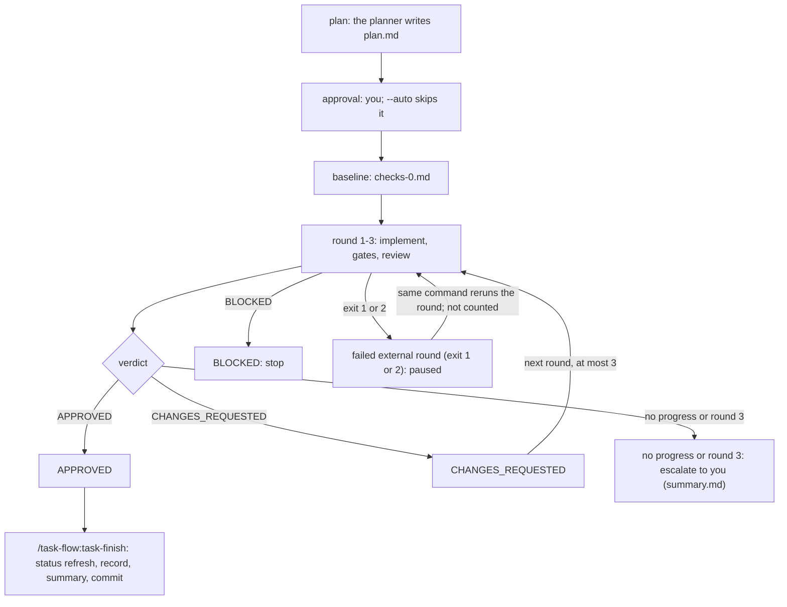

# Commands

Paths such as `scripts/…`, `skills/…`, `agents/…`, `templates/…` and `bench/…` are inside `plugins/task-flow/`.

## One task, start to finish

One `/task-flow:task-run` from the request to the verdict: you approve the plan, the
baseline check runs on the untouched base, then rounds 1–3 loop implement → gates →
review until APPROVED, escalation or a stop.

<!-- diagram:task-flow -->

<!-- /diagram:task-flow -->

The diagram cannot carry: the round cap and the no-progress rule are compared
mechanically on the failing sets of two consecutive rounds; a failed external round
leaves the phase `implementing`, so the same command runs it again. The finish node's
SDLC status refresh is opt-in: it runs only when the worktree has
`docs/task-flow/sdlc-status.toml` and the task's `task.md` declares
`SDLC criteria closed by this task:` — otherwise `task-finish` changes no status file
(see [AI-native SDLC status](ai-native-sdlc.md)). The finish node's task record is
likewise opt-in: when the worktree's `.claude/task-flow.records.toml` has
`[records] enabled = true`, `scripts/task_record.py` renders `docs/tasks/<id>.md` and
prints the `Task-*` commit trailers before the commit; otherwise no record and no
trailers (see [Task records](configuration.md#task-records-recordstoml)).

Plugin commands are namespaced, so each is `/task-flow:<name>`:

| Command | What it does |
| --- | --- |
| `task-new <description>` | Creates `.work/<id>/task.md` and `status.md`; asks at most 2 questions |
| `task-plan [id]` | Runs the planner, shows the plan, asks you to approve, edit or cancel |
| `task-implement [id]` | Requires approval; runs the baseline check first (creates the branch and worktree); runs the implementer: the subagent, or `implement.py` when `[roles] implementer` names a profile |
| `task-check [id]` | Runs the checker for the current round |
| `task-review [id]` | Runs the reviewer for the current round |
| `task-run <description \| id> [--auto]` | All of the above, with the approval gate and the 3-round cap |
| `task-autopilot [<requirements> \| <run-id> \| --tasks <id>[,<id>...]] [--from-repo] [--semi \| --full] [--budget <tokens>] [--auto]` | Gathers requirements, plans them as a stack of tasks, shows tasks and token estimates, then runs them one after another; `--tasks` runs existing prepared tasks stacked in the given order (see Autopilot) |
| `task-epic <new <epic-id> --title <title> --goal <goal> --base <branch> [--tasks <id>[,<id>...]] \| add <epic-id> --tasks <id>[,<id>...] \| remove <epic-id> --tasks <id>[,<id>...] \| run <epic-id> \| status <epic-id> \| retry <epic-id> <task-id> --authorized \| sync-run <epic-id>>` | Creates a persistent epic (one id for a group of tasks with declared dependencies) before execution, mutates its membership while idle (regenerating the linked run's table), runs or resumes it through the ordinary autopilot loop (`source: epic`), and reports status; retry of a failed member needs your explicit authorization (see [Autopilot and epics](autopilot.md#epics)) |
| `task-list [--all] [--epic <epic-id>]` | Open tasks as a table, ordered by what to do next; `--all` includes done ones, `--epic` lists only that epic's member tasks |
| `task-status [id]` | Phase, round and last verdict for one task or all |
| `task-finish [id]` | After `APPROVED`: refreshes the AI-native SDLC status when the repository has `docs/task-flow/sdlc-status.toml` and `task.md` declares criteria (`scripts/sdlc_status.py finish`, before the commit); when the worktree's `.claude/task-flow.records.toml` enables records, also renders `docs/tasks/<id>.md` and the `Task-*` trailers (`scripts/task_record.py`, before the commit, stopped-on-error); then summary (fixed headings), commit message, PR text; local commit; asks before push or PR; last, prunes `.work/<id>/` to its `.md` and `impl-*.json` files (not asked) |
| `task-release [<version> \| --major \| --minor \| --patch] [--target <name>] [--since <ref>] [--dry-run]` | Releases one target: preconditions, version proposal, checks, changelog entry, one approval, version bump, release commit and annotated tag; push only after a separate question (see Releasing) |
| `task-doctor [--online]` | Read-only check of the environment and configuration (uv, git, permissions, `models.toml`, keys); prints a fix for every WARN and FAIL (see Doctor) |

`task-list` runs `scripts/task_list.py` and sorts rows by phase group, then oldest last
History entry first, then id. The Epic column shows the epic a task belongs to (`-` when
none); `--epic <epic-id>` lists only that epic's member tasks (an unknown epic id exits
2). Epics themselves (`.work/_epics/<epic-id>/`) are never listed as tasks:

1. waiting on you: `planned`, `blocked`, `escalated`;
2. in progress: `approved`, `baseline`, `implementing`, `checking`, `reviewing`,
   `review-approved`;
3. not started: `new`;
4. unrecognised or missing phase;
5. `done` (only with `--all`).

The timestamp is the first word of the last `## History` bullet; one without a zone counts
as UTC, and a missing or unparseable one sorts last within its group. Round and last
verdict are shown but do not affect the order.

`--auto` skips only the plan approval question. It never allows an early stop, a push, a PR
or a deploy. A run stops only at the approval gate (skipped by `--auto`), a `BLOCKED`
agent, `APPROVED`, no progress, or the round cap; the last four apply with or without
`--auto`.
Every run can be resumed with `task-run <id>` or the single-step commands, because the
phase is in `status.md`.
