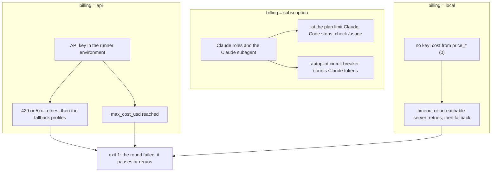
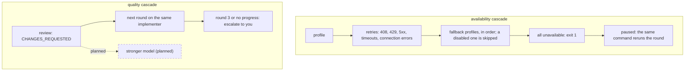
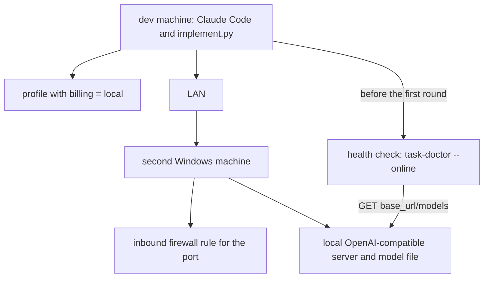

# External implementer

Paths such as `scripts/…`, `skills/…`, `agents/…`, `templates/…` and `bench/…` are inside `plugins/task-flow/`.

**Experimental.** `scripts/implement.py` performs ONE implementer round with an external
model instead of the Claude `implementer` subagent: an OpenAI-compatible chat model
(`openai-loop` — the Mistral API, any OpenAI-compatible host, a local llama.cpp server) or
Anthropic through the native Messages API with prompt caching (`anthropic-loop`); the
per-provider wire formats live in `scripts/drivers.py`. Only the Mistral API has been
exercised so far (see [Limits, stated plainly](#limits-stated-plainly));
the configuration and the `impl-<n>.json` format may still change between versions. To
switch it off again, see [Rolling back](#rolling-back). It follows the same contract as
`agents/implementer.md` (that file's body is its system prompt, plus the Conventions of
the plan's profiles).

## Billing modes

What `billing` changes at run time: who pays, and what a failure does. Only the effects
the code has today are drawn — cost comes from the `price_*` keys in every mode, and
`max_cost_usd` caps the whole run.



The diagram cannot carry: the bench labels a `subscription` profile `subscription` in
its cost columns and draws no cost bar for it.

## Two cascades

Where escalation exists today: only to you, the human. Escalation to a stronger model is
not built.



The diagram cannot carry: after the retries of one profile the next `fallback` profile
is tried within the same round; exit 1 or 2 leaves the phase `implementing`.

## Local model (proof of concept)

This is untested: no local server has been exercised (see
[Limits, stated plainly](#limits-stated-plainly)). A profile for one would be
`[profiles.local]` with `driver = "openai-loop"`, `base_url = "http://<host>:<port>/v1"`
(your placeholders, written here in prose, not in a diagram label), the served `model`
id, `billing = "local"` — which needs no `api_key_env` — and `enabled = false` until you
opt in. The second machine runs an external local OpenAI-compatible server, e.g.
llama.cpp's `llama-server` with a model file (an external tool, not part of this
repository), behind an inbound firewall rule for the port (external: a Windows firewall
cmdlet). Before the first round, check the server from the development machine:
`/task-flow:task-doctor --online` sends one `GET <base_url>/models` per enabled profile
in use, which for a local profile needs no key; if the server is llama.cpp, its
`/health` endpoint is the equivalent external check.



## Routing

With `[roles] implementer = "<profile>"` in `models.toml`, `task-run`, `task-implement` and
the autopilot loop run `implement.py` for the implement phase instead of the
`task-flow:implementer` subagent. With `claude`, any `claude:*` value or no config, the
subagent runs with the `claude:*` model passed as its subagent call's `model` argument
(see "Choosing Claude models per role"); with bare `claude` or no config, exactly as
before. The orchestrator resolves the roles with `models.py roles`. `implement.py` runs in
the background and the orchestrator reads its exit code and result line. A failed round
(exit 1 or 2) leaves the phase `implementing`; the same command (`task-run <id>` or
`task-implement <id>`) runs that round again, and whatever the failed round already staged
stays in the worktree, so the next run starts from that state. In an autopilot run a
failed round pauses the run (also with `--auto`) and `/task-flow:task-autopilot <run-id>`
resumes it. An external round adds nothing to the task's `Tokens used` (that column stays
Claude subagents only); after each external round that exits 0, 1 or 3 the orchestrator
adds the round's `cost_usd` from `impl-<n>.json` to the task's `External USD` column in
`run.md`, in plain decimal notation (`autopilot.py` also accepts scientific notation; 6
decimal places are enough because `implement.py` rounds `cost_usd` to 6) — exit 2 adds
nothing — and the run's History records `implementer <profile>: <cost_usd> USD external`.
`report.md` reports both currencies:
Claude tokens used and external USD. The burn-rate and budget triggers count Claude tokens
only, compared against estimates whose implement term is 0 when the implementer is an
external profile (`autopilot.py estimate|next --implementer-kind profile`).

Example `models.toml` (the model id is a placeholder):

```toml
[profiles.mistral]
driver = "openai-loop"
base_url = "https://api.mistral.ai/v1"
model = "<model id from GET /v1/models>"
api_key_env = "MISTRAL_API_KEY"
billing = "api"

[roles]
implementer = "mistral"
```

Set the key in the environment Claude Code is started from. PowerShell:

```powershell
$env:MISTRAL_API_KEY = "..."
# persistently, for new processes:
[Environment]::SetEnvironmentVariable("MISTRAL_API_KEY", "...", "User")
```

POSIX shells: `export MISTRAL_API_KEY=...`. Restart Claude Code from that environment.
`/task-flow:task-doctor --online` then verifies the key and the model id against the
provider's model list.
The orchestrator needs the permission `Bash(uv run:*)` to start the scripts.

Privacy: the provider receives the worktree code and the task files. Opting out of
training is set at the provider, not here. The guard hook (`guard.py`) does not see the
external model's commands; `implement.py` calls the same rules from `scripts/rules.py`
with the `external-implementer` role, with the limits below.

To try it by hand:

```
uv run --script plugins/task-flow/scripts/models.py roles
uv run --script plugins/task-flow/scripts/models.py role implementer
uv run --script plugins/task-flow/scripts/models.py show <profile>
```

then the `implement.py` command:

```
uv run --script plugins/task-flow/scripts/implement.py \
    --task-dir .work/<task-id> --worktree <path|none> --round <n> [--profile <name>] \
    [--heartbeat <seconds>] [--verbose]
```

`--worktree none` means the repository root, which is the parent of the `.work` folder that
holds the task. Without `--profile`, `[roles] implementer` must name a profile.
`--heartbeat <seconds>` sets the interval of the heartbeat lines on stderr while a request or
a command runs (default 30, `0` disables, a negative value is refused); `--verbose` also
logs the model's text content of each response. Progress goes to stderr; stdout gets one line:

| Exit | stdout line | Meaning |
| --- | --- | --- |
| 0 | `ok: <k> files changed (<profile>/<model>, <turns> turns, $<cost>)` | round done, changes staged |
| 1 | `failed: <reason>` | the loop ran but did not finish: every profile unavailable, a non-retryable HTTP error, `max_turns`, `max_cost_usd` or `max_context` exceeded |
| 2 | `refused: <reason>` | nothing was sent to any model: bad arguments or config, plan not approved, `checks-0.md` or `review-<n-1>.md` missing, worktree missing, profile unknown, disabled or without its key |
| 3 | `blocked: <reason>` | the model reported that the plan is wrong |

Prerequisites when running by hand are listed under "Limits, stated plainly" below.

## Providers

`scripts/drivers.py` holds one driver per `driver` value; `implement.py` sends the same
prompt, tools, conversation and results through either of them:

| Provider | `driver` | `base_url` | Key variable | Prompt caching | Status |
| --- | --- | --- | --- | --- | --- |
| Mistral | `openai-loop` | `https://api.mistral.ai/v1` | `MISTRAL_API_KEY` | provider-side; cached tokens reported in the usage | exercised (this repo's own profiles) |
| OpenAI | `openai-loop` | `https://api.openai.com/v1` | `OPENAI_API_KEY` | provider-side; cached tokens reported in the usage | untested against the real API |
| Anthropic | `anthropic-loop` | `https://api.anthropic.com/v1` | e.g. `TASK_FLOW_ANTHROPIC_KEY` | `cache_control` breakpoints on the request; cache-aware cost | untested against the real API |
| any other OpenAI-compatible host, local llama.cpp | `openai-loop` | the host's base URL | the host's variable | depends on the host | untested |

Mistral (as in this repository's [`.claude/task-flow.models.toml`](../../.claude/task-flow.models.toml)):

```toml
[profiles.mistral]
driver = "openai-loop"
base_url = "https://api.mistral.ai/v1"
model = "mistral-large-4-0"          # or "mistral-small-2603"
api_key_env = "MISTRAL_API_KEY"
billing = "api"
max_turns = 60
max_cost_usd = 1.50
price_input_per_mtok = 0.70
price_cached_input_per_mtok = 0.07
price_output_per_mtok = 2.10
```

OpenAI — **unverified until a first real call**. Reasoning models want `temperature`
unset, `max_tokens_param = "max_completion_tokens"` and the effort in `extra_body`:

```toml
[profiles.openai]
driver = "openai-loop"
base_url = "https://api.openai.com/v1"
model = "<model id from GET /v1/models>"
api_key_env = "OPENAI_API_KEY"
billing = "api"
max_tokens_param = "max_completion_tokens"
# extra_body = { reasoning_effort = "medium" }
```

Claude on the native Messages API, Sonnet 5.5 or Haiku 5.5 — prices are USD per 1M tokens
as of 2026-11-01, check the provider's pricing page; Sonnet 5.5: $2.00 input / $10.00
output / $0.20 cache read, Haiku 5.5: $0.10 / $0.50 / $0.01, cache write (5-minute TTL)
1.25x the input price:

```toml
[profiles.claude]
driver = "anthropic-loop"
base_url = "https://api.anthropic.com/v1"
model = "claude-sonnet-5-5"           # or "claude-haiku-5-5"
api_key_env = "TASK_FLOW_ANTHROPIC_KEY"
billing = "api"
price_input_per_mtok = 2.00
price_cached_input_per_mtok = 0.20
price_cache_write_per_mtok = 2.50     # 1.25x the input price; Haiku: 0.125
price_output_per_mtok = 10.00
# no temperature: the pinned API version rejects it on every model
# extra_body = { output_config = { effort = "medium" } }   # optional
```

Fallback across providers — try Mistral first, then Claude:

```toml
[profiles.mistral]
driver = "openai-loop"
base_url = "https://api.mistral.ai/v1"
model = "mistral-large-4-0"
api_key_env = "MISTRAL_API_KEY"
billing = "api"
fallback = ["claude"]

[profiles.claude]
driver = "anthropic-loop"
base_url = "https://api.anthropic.com/v1"
model = "claude-haiku-5-5"
api_key_env = "TASK_FLOW_ANTHROPIC_KEY"
billing = "api"
```

Never use `api_key_env = "ANTHROPIC_API_KEY"`: in a Claude Code session that variable
makes Claude Code itself bill by API token instead of the subscription. `models.py show`
prints a warning on stderr for such a profile and `implement.py` logs it before the
round; use another name, e.g. `TASK_FLOW_ANTHROPIC_KEY`.

Anthropic also serves an OpenAI-compatible endpoint at the same `base_url`, which works
through `openai-loop` as a quick test path — but without prompt caching and with empty
cached-token usage, so `cache_tokens` stays zero and cost is not cache-aware. Use
`anthropic-loop` for real work.

## Post-edit feedback and prompt extras

Two optional profile keys give the external model the after-edit feedback that Claude
subagents get from dev-baseline's `format_python.py` PostToolUse hook. Without them,
nothing the external implementer does changes.

`post_edit` is a list of commands run after each *successful* `write_file` /
`edit_file` call — not after `run_command`, and not after a denied or failed write.
Every literal `{path}` in a command is replaced by the written file's worktree-relative,
`/`-separated path, quoted for the platform; a command without `{path}` still runs
after each write. Each command goes through the same path as `run_command` — the same
`rules.py` checks with the `external-implementer` role, no shell, the worktree as the
working directory, `command_timeout_seconds`, and its duration counted in
`command_seconds` / `slowest_command` — so on Windows a `.cmd`/`.bat` `post_edit`
command has the same limits as a `run_command` one (see
[Limits, stated plainly](#limits-stated-plainly)). Per command, appended to that tool
call's result after a blank line:

```
post_edit: <command as run> (exit code <n>)
<output, capped to 40 lines, then ...[<k> more lines] when cut>
```

or `(denied: <reason>)`, `(error: <message>)` or `(timed out after <s> s and was
killed)` instead of the exit code. A denial, a missing program, a timeout or a non-zero
exit is feedback text only — it never fails, blocks or ends the round. A command that
exits 0 with empty output appends nothing (a clean hook is silent). Because a
`post_edit` command such as a formatter can change the file after the model wrote it,
the model's next `edit_file` may find its `old` text no longer present; the feedback
output tells it.

`prompt_extras` is a list of files read before the round; each file's contents are
appended to the system prompt as `# Extra instructions: <path as configured>`, in list
order, **before** the runner adapter section — so an extra file cannot override the
adapter's rules. `~` is expanded; a relative path resolves against the repository root
(the parent of `.work/`), not the worktree, so an untracked local file works. A missing,
unreadable or non-UTF-8 file refuses the round (exit 2, nothing sent, nothing written):
a typo must not silently drop part of the prompt. A `fallback` profile reuses the
starting profile's `prompt_extras` (one system prompt per round) but runs its own
`post_edit`.

Example — run the project's formatter and habit-hooks on every written file (check
habit-hooks' own documentation for its flags):

```toml
[profiles.mistral]
# ... the keys from the table above ...
post_edit = [
  "uvx ruff format {path}",
  "uvx ruff check --fix {path}",
  "habit-hooks --file {path}",
]
```

habit-hooks' exit codes are all returned as feedback, never as a failure of the round:
0 clean, 1 an enforced finding, 2 the tool itself failed. Caveat: task-flow keeps the
changes staged and uncommitted in the worktree, so with `[scope] changedOnly = true` a
plain `habit-hooks` run (without `--file`) covers every file the task has changed so
far, not only the one just written; `--file` checks one file and ignores snoozes. The
snooze denial above applies to the external implementer too, so `post_edit` cannot run
`habit-snooze --snooze` or `--prune`.

Nothing here is installed or vendored, and the round does not depend on these tools: a
missing program is reported as `error:` feedback, never as a round failure.

To try [ponytail](https://github.com/DietrichGebert/ponytail)'s `AGENTS.md` — downloaded
by you, not vendored here — with the external implementer, reference it via
`prompt_extras`:

```toml
prompt_extras = ["AGENTS.md"]
```

Its benchmark numbers are the author's own.

## What it does and records

The model gets seven tools: `read_file`, `write_file`, `edit_file` (the old text must occur
exactly once), `list_files`, `grep`, `run_command` and `blocked`. The file tools are
confined to the worktree and cannot write under `.git` or `.work`. `run_command` denies the
commands `rules.py` denies for the `external-implementer` role — the same rules the
`guard.py` hook applies to the Claude agents. On a retryable failure that outlasts `retries`, the run restarts on the next
`fallback` profile with the same prompt and a note that the worktree may hold partial
changes; any other 4xx fails without fallback.

After the loop it stages what the round produced and never commits:

- tracked modifications and deletions (`git add -u`), including the ones commands made;
- a pre-existing untracked file only when the model wrote or edited it with `write_file` /
  `edit_file`;
- any other new file — one the file tools created or one a command created (`run_command`,
  e.g. a generated source file or a lock file) — unless `.gitignore` or `.git/info/exclude`
  ignores it;
- never a build artifact: a path with a `__pycache__/`, `.pytest_cache/`, `.ruff_cache/` or
  `.mypy_cache/` component, a `*.pyc` / `*.pyo` file, `.DS_Store` or `Thumbs.db`. An
  artifact is never staged while untracked, even when the model wrote it; a tracked
  artifact is a project decision and follows `git add -u`.

It appends to `status.md` only under
`## Log`: one `round <n> implementer: <path> (A|M|D)` line per changed file (or `no files
changed`) on ok, `BLOCKED: <reason>` on blocked, nothing on failed. It also writes
`<task-dir>/impl-<n>.json` for exit 0, 1 and 3: `profile`, `model`, `turns`, `tokens`
(`input`, `cached`, `output`), `cache_tokens` (`read`, `write`: prompt-cache read and
write tokens summed over all profiles; on `anthropic-loop` `tokens.input` is one
request's total prompt — uncached + cache-creation + cache-read — and `cache_tokens`
separates the cache parts), `cost_usd`, `duration_seconds`, `status`, `reason`,
`fallback_chain`, `settings` (`temperature`, `max_output_tokens`, `extra_body`) and
`files_changed`, plus the timing keys `model_seconds` (sum of all HTTP attempt durations,
successful or not, excluding backoff waits), `retry_wait_seconds` (sum of the backoff sleeps),
`command_seconds` (sum of the `run_command` durations), `slowest_request` (`turn`, `profile`,
`seconds`, `outcome` — `ok` or the retry reason — of the slowest single HTTP attempt, or
`null`) and `slowest_command` (`turn`, `command`, `seconds`, `timed_out`, or `null`); every
`fallback_chain` entry also carries `retries`, one `turn`, `reason`, `attempt_seconds`,
`wait_seconds` object per failed attempt that was followed by another one on the same
profile (`[]` when none).

While it runs, stderr shows one line per tool call and one for the final message, each
starting `[implement] turn N (<req> s, <in> in / <out> out, $<cost> total):` — `<req>` the
wall seconds of that turn's request including retries and waits, `<in>`/`<out>` the turn's
prompt/completion tokens (`12.3k` from 1000 on), `<cost>` the running total — and a
`run_command` line reads `run_command [<secs> s] -> <result>`. With `--heartbeat` it also
logs `waiting for <profile> ... <elapsed> s` while a request is in flight and
`running <command> ... <elapsed> s` while a `run_command` runs, so a slow round is
distinguishable from a hung one. `--verbose` additionally logs `turn N text: <content>` for
each response whose content is a non-empty string.

Each counted turn also appends one compact JSON line to
`<task-dir>/impl-<n>.progress.jsonl` — `turn`, `profile`, `tools`, `request_seconds`,
`retries`, `command_seconds`, `tokens` (`input`, `cached`, `output`), `cost_usd`,
`elapsed_seconds` — opened, written, flushed and closed per line, so a killed round still
leaves its complete turns behind. The file is created empty only after the preconditions
pass (a refusal writes nothing) and a re-run of the same round starts it afresh. It is
scratch: `/task-finish` deletes it, because prune keeps only `impl-*.json`.

## Limits, stated plainly

- Running by hand needs a prepared task: the baseline run is done (`checks-0.md` exists),
  the worktree exists and `status.md` says `plan-approved: yes`.
- Commands the model runs are matched as text only. A `python -c` or a script can still
  push or commit; nothing here can see what a program does.
- There is no shell: no pipes, redirects or `&&` in a command, for any tool. On Windows,
  a program that resolves to a `.cmd`/`.bat` file (`npm`, `npx`, `mvn.cmd`,
  `gradlew.bat`) is started through `cmd.exe /d /s /c` with one quoted command line
  (`scripts/launch.py`), and such a command is rejected if it contains `& | < > ^ % !`
  or a newline, inside quotes too — so e.g. `npm run build -- --flag=%X%` or an argument
  with `&` cannot be passed to a `.cmd` tool; call the underlying `.exe` directly
  instead.
- The network access of commands is not blocked.
- `post_edit` commands run only after the file tools (`write_file` / `edit_file`), never
  after `run_command`.
- The code in the worktree, and the task files, are sent to the provider you configured.
- Commands get only an allowlist of the environment: `PATH`, `PATHEXT`, `SYSTEMROOT`,
  `COMSPEC`, `TEMP`, `TMP`, `TMPDIR`, `HOME`, `USERPROFILE`, `APPDATA`, `LOCALAPPDATA`,
  `LANG`, `LC_*`, `TERM`, `CI`, `VIRTUAL_ENV`, `UV_*` and `PYTHON*`. Tokens, cloud
  credentials and API keys of any other name never reach them.
- `implement.py` stages only what the round produced (see above): pre-existing untracked
  files and build artifacts such as `__pycache__/` are never staged. The Claude
  `implementer` subagent still runs `git add -A` (`agents/implementer.md` step 8), so in a
  repository without a `.gitignore` it stages pre-existing untracked files such as
  `__pycache__/` — add a `.gitignore` entry or unstage them before finishing.
- A new file a command creates is staged unless it is ignored or on the artifact list
  above: in a repository without a `.gitignore`, a `node_modules/` or `dist/` a command
  creates would be staged.
- There is no context compaction. Every request resends the whole conversation so far;
  only each tool result is truncated. With `max_context` set, a response that reports
  more prompt tokens than `max_context` fails the round (exit 1); without it, the round
  runs until the provider refuses the request, which fails it too.
- Only the Mistral API (`https://api.mistral.ai/v1`) has been exercised against a real
  provider. `openai-loop` on other hosts (OpenAI itself, any OpenAI-compatible host, a
  local llama.cpp server) and `anthropic-loop` are untested against the real APIs; their
  tool calls, usage figures and error codes may differ. `anthropic-loop` pins
  `anthropic-version: 2026-10-21` on every request, so a future API version needs a code
  change.
- Haiku 5.5 (`claude-haiku-5-5`) costs more above 100k prompt tokens per request
  ($0.50 / $2.50 per 1M instead of $0.10 / $0.50); flat profile prices under-count such
  requests. Set `max_context = 100000` on a Haiku profile when the price ceiling matters —
  that fails the round (exit 1) rather than limiting it.
- The provider decides a model's status: a model can be in public preview, renamed or
  retired without task-flow knowing. Check the provider's model list (`GET /v1/models`)
  and documentation before you set `model`, and give the profile a `fallback`.

## Rolling back

To stop using the external implementer, set this in the project file
`.claude/task-flow.models.toml`, which wins over the user file:

```toml
[roles]
implementer = "claude"
```

or remove the `implementer` key from `[roles]` in both files (without any `models.toml`,
nothing changes either). `uv run --script plugins/task-flow/scripts/models.py role
implementer` then prints `claude`, and the next round runs the `task-flow:implementer`
subagent again.

To go back to an earlier task-flow release, pin the marketplace to that release's tag.
[`/task-flow:task-release`](releasing.md#releasing) creates the tags as `task-flow-<version>` (the
`tag` pattern in this repository's `.claude/task-flow.release.toml`), so this works only
for versions released that way; before the first release there is no tag to pin. In a
Claude Code session:

```
/plugin marketplace add jakos/claude-baseline#task-flow-<version> --scope user
```

then, in a shell, `claude plugin update task-flow@claude-baseline`; the pinned version
loads in the next session or after `/reload-plugins`. `#<ref>` takes a branch or a tag,
and `jakos/claude-baseline@<ref>` is the same; see
[Host and maintain a marketplace](https://code.claude.com/docs/en/plugins/host-marketplace)
in the Claude Code documentation. A marketplace is registered once per `name`, so the
pinned catalog takes the place of the unpinned `claude-baseline` one, and the pin applies
to the whole catalog: `dev-baseline` is held at the same tag. To return to the latest
version, add `jakos/claude-baseline` again without `#<ref>` and update the plugin the
same way. Do not use `/plugin marketplace remove` for this: removing a marketplace
uninstalls every plugin installed from it.
