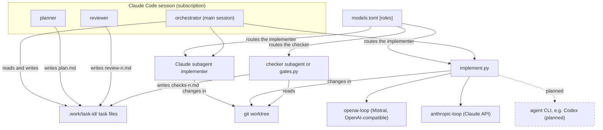

# task-flow overview

Paths such as `scripts/…`, `skills/…`, `agents/…`, `templates/…` and `bench/…` are inside `plugins/task-flow/`.

## Architecture

The roles in one Claude Code session exchange nothing but the task files in
`.work/task-id/`; `models.toml` routes the implementer and the checker, and every
implementer writes in the git worktree.

<!-- diagram:architecture -->

<!-- /diagram:architecture -->

The diagram cannot carry: the API key of an external profile lives only in the runner's
environment, never in `models.toml`; with `checker = "script"` the gate is
`scripts/gates.py`, not the checker subagent; no agent-CLI driver is built yet.

A multi-agent workflow for tasks and feature requests:

```
/task-flow:task-run "<request>"
  → planner (opus) writes plan.md
  → you approve, edit or cancel          ← nothing is built before this
  → checker (haiku) runs on the untouched base → checks-0.md
  → round 1..3:
       implementer (sonnet) changes code in a worktree
       checker (haiku) runs tests, lint, builds  → checks-n.md
       reviewer (opus) judges each criterion     → review-n.md
       APPROVED → stop   CHANGES_REQUESTED → next round
       same introduced failures as the round before (no progress), or round 3 → escalate to you
  → /task-flow:task-finish commits, asks before push or PR, then prunes the task folder to its .md files and impl-*.json metrics
```

The models in the diagram are the defaults from each agent file's frontmatter. An
optional `models.toml` can change the Claude model of any role and can hand the
implementer role to a non-Claude model; see
[Choosing Claude models per role](configuration.md#choosing-claude-models-per-role) and
[External implementer](external-implementer.md#external-implementer).

Each role is a separate subagent with a fresh context. They share nothing but files in
`.work/<task-id>/`, so the reviewer sees the plan, the diff and the check results — never
the implementer's reasoning.

Installing and first-running the plugin is covered in [Setting up task-flow](setup.md).

## AI-native SDLC status

task-flow's purpose is an AI-native SDLC: agents plan, build, check and review under
human gates — assisted autonomy, never unattended. The current status of every SDLC
stage is not maintained by hand: `scripts/sdlc_status.py` generates the `sdlc:status`
block of the front page and the whole [AI-native SDLC status](ai-native-sdlc.md) page
from `docs/task-flow/sdlc-status.toml`, and `check` runs as one of this repository's
gates. The capability is opt-in per repository: without that source file the script is
a no-op and nothing changes; `/task-flow:task-finish` runs its `finish` command so a
task that declares `SDLC criteria closed by this task:` in its `task.md` has its
criteria marked and the pages re-rendered before its commit.

## Layout

```
.claude-plugin/plugin.json      manifest; depends on dev-baseline
agents/                         planner, implementer, checker, reviewer, backlog
skills/workflow/                shared contract (SKILL.md) + orchestration.md for commands
skills/profile-*/               python, docs, config, generic
skills/task-*/                  the 12 commands
hooks/hooks.json, scripts/rules.py, scripts/guard.py, scripts/task_list.py,
scripts/prune_task.py, scripts/autopilot.py, scripts/implement.py, scripts/drivers.py,
scripts/launch.py, scripts/gates.py, scripts/models.py, scripts/release.py,
scripts/doctor.py               read-only environment and configuration check (task-doctor)
scripts/sdlc_status.py          SDLC status: validate, check, render, done and finish
                                (opt-in per repository; see AI-native SDLC status above)
bench/bench.py, bench/publish.py, bench/README.md  benchmark harness and publisher:
                                implementer profiles on frozen cases, cost per accepted
                                task, and the published benchmark pages (see Benchmark)
bench/cases/<id>/               frozen benchmark cases: case.toml, plan.md, NOTES.md
bench/results/log.md            generated results log over the saved runs (bench.py log)
templates/task-flow.md          project config example
templates/models.toml           commented models.toml example (profiles, [roles], [gates])
templates/release.toml          commented release config example (targets, version files)
tests/test_drivers.py, tests/test_doctor.py
                                offline suites for scripts/drivers.py and scripts/doctor.py
                                (the other test_*.py suites cover the other scripts)
tests/test_bench.py             offline suite for bench/bench.py
tests/test_bench_publish.py     offline suite for bench/publish.py
tests/test_docs.py              offline suite for the docs pages and their links
tests/test_sdlc_status.py       offline suite for scripts/sdlc_status.py
```
